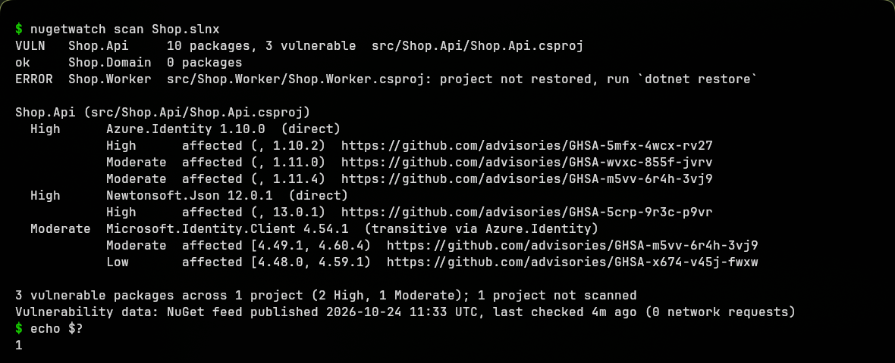
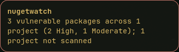

# nugetwatch

[](https://github.com/Erion14/nugetwatch/actions/workflows/ci.yml)

`nugetwatch` scans restored .NET projects for NuGet packages with known
vulnerabilities, including transitive ones, and can send a desktop
notification. It's a single static Go binary with no dependencies outside the
standard library. It doesn't need the .NET SDK, and after the first run it
usually works offline in a few tens of milliseconds.



With `--notify` it sends one desktop notification that summarises the run
(shown here with dunst):



## Install

With Go 1.25 or newer:

```sh
go install github.com/Erion14/nugetwatch/cmd/nugetwatch@latest
```

Or download a binary for Linux, macOS or Windows from the
[releases page](https://github.com/Erion14/nugetwatch/releases) and put it on
your `PATH` (for example `~/.local/bin`).

## Usage

```
nugetwatch scan [paths...] [--json] [--sarif] [--notify] [--notify-always] [--fail-on LEVEL]
nugetwatch version
```

A path can be a solution (`.sln`, `.slnx`), a project (`.csproj`, `.fsproj`,
`.vbproj`), or a directory. Directories are searched recursively, skipping
`bin`, `obj`, `node_modules` and hidden directories. Flags may go before or
after the paths.

| Flag | Meaning |
|---|---|
| `--json` | Write a machine-readable report to stdout. |
| `--sarif` | Write SARIF 2.1.0 for GitHub code scanning. |
| `--notify` | Send one desktop notification if vulnerabilities are found, or if the run fails. |
| `--notify-always` | Also send a notification when the scan is clean. |
| `--fail-on LEVEL` | Lowest severity that counts as a finding: `low` (default), `moderate`, `high` or `critical`. Lower-severity findings are still listed, but they don't affect the exit code or trigger notifications. Advisories with no severity always count. |

**Exit codes:** `0` clean, `1` vulnerabilities found, `2` usage or tool error.
The tool also exits with `2` when vulnerability data can't be loaded, or when
none of the projects could be scanned. Failed notifications only print a
warning and never change the exit code.

### Configured projects

If you run `nugetwatch scan` without paths, it reads
`$XDG_CONFIG_HOME/nugetwatch/projects` (usually
`~/.config/nugetwatch/projects`). The file has one path per line, and lines
starting with `#` are comments. A leading `~/` is expanded, and relative paths
are resolved against your home directory.

```
# ~/.config/nugetwatch/projects
~/src/shop/Shop.sln
~/src/tools/Importer/Importer.csproj
```

### CI / GitHub code scanning

```yaml
- run: dotnet restore
- run: nugetwatch scan . --sarif > nugetwatch.sarif || true
- uses: github/codeql-action/upload-sarif@v3
  with:
    sarif_file: nugetwatch.sarif
```

## Daily scans with systemd

`contrib/systemd` contains a user service and timer. The timer runs once a
day with `Persistent=true`, so if the laptop was off at the scheduled time,
the scan runs as soon as it's back on.

```sh
install -Dm755 nugetwatch ~/.local/bin/nugetwatch      # or go install, adjust ExecStart
install -Dm644 contrib/systemd/nugetwatch.service ~/.config/systemd/user/
install -Dm644 contrib/systemd/nugetwatch.timer   ~/.config/systemd/user/
systemctl --user daemon-reload
systemctl --user enable --now nugetwatch.timer

systemctl --user start nugetwatch.service   # run once now
journalctl --user -u nugetwatch.service     # see the report
```

The service runs `nugetwatch scan --notify` and treats exit code `1` as a
success, so finding vulnerabilities doesn't mark the unit as failed.

**Notifications from systemd:** `notify-send` needs the session D-Bus and a
running notification daemon, such as mako, dunst, swaync or the one your
desktop provides. Most systemd user sessions already have
`DBUS_SESSION_BUS_ADDRESS` set. If notifications work in a terminal but not
from the timer, uncomment this line in the service:

```ini
Environment=DBUS_SESSION_BUS_ADDRESS=unix:path=%t/bus
```

Or import the variable from your compositor or WM startup, for example with
`exec-once = dbus-update-activation-environment --systemd DBUS_SESSION_BUS_ADDRESS`
in Hyprland.

## How it works

1. **Discovery.** It finds project files from the given paths. For each
   project, it reads the dependency graph that NuGet resolved during restore
   from `obj/project.assets.json`, falling back to `packages.lock.json`. It
   never runs `dotnet`.
2. **Dependency graph.** For each target framework, it walks the graph from the project's
   top-level dependencies (package and project references). Every package
   records whether it is direct and which top-level dependencies pull it in.
   Packages are deduplicated across target frameworks by ID and version.
3. **Vulnerability data.** It starts at the NuGet V3 service index
   (`https://api.nuget.org/v3/index.json`) and finds the `VulnerabilityInfo`
   resource. It then downloads the pages listed there: a `base` page, plus an
   `update` page with anything newer. Each page maps a lower-case package ID
   to entries like `{"url", "severity": 0-3, "versions": "(, 13.0.1)"}`.
4. **Caching.** Responses are stored in `$XDG_CACHE_HOME/nugetwatch`. The tool
   follows the server's `Cache-Control: max-age` (6 hours for the indexes, 7
   days for data pages) and then revalidates with `If-None-Match` /
   `If-Modified-Since`. In most runs it makes no requests or a few `304`s.
   Superseded pages are pruned. If the feed can't be reached, it uses the
   cached data and prints a warning that the data is stale. If there is no
   cache, it exits with `2`.
5. **Matching.** Package IDs are compared case-insensitively. The resolved
   version is checked against each advisory's NuGet version range (`[1.0,2.0)`,
   `(,1.0]`, `[1.2.3]`, and so on) using NuGet's version ordering. This covers
   SemVer 2 prereleases, an optional 4th component, and ignored build metadata.
   Projects are parsed concurrently with a bounded worker pool while the feed
   loads.

Each finding reports the severity, advisory URL and affected range. The feed
has no "fixed in" field, so nugetwatch doesn't report one. Check the advisory
for the patched version.

Set `NUGETWATCH_SERVICE_INDEX` to use a different V3 service index, for
example a mirror that provides `VulnerabilityInfo`.

## Limitations

- **NuGet's feed only.** The data comes from nuget.org's `VulnerabilityInfo`
  feed, which is GitHub Advisory Database data for NuGet. There is no OSV or
  other fallback yet.
- **A restore is required.** nugetwatch reads restore output, so each project
  must have been restored at least once. Results reflect the last restore: if
  you edited package references since then, run `dotnet restore` again.
  Projects that haven't been restored are reported as errors, and the rest of
  the run continues.
- **Default `obj` location only.** It doesn't follow a custom
  `BaseIntermediateOutputPath` or the .NET 8 artifacts output layout.
- **No fixed versions.** See above.
- **Linux-only notifications.** The tool builds and scans on macOS and
  Windows, but `--notify` only works on Linux (`notify-send`).
- Projects inside directories named `bin`, `obj` or `node_modules`, or inside
  hidden directories, are skipped when scanning a directory. Pass the solution
  or project file directly if you need them.

## Development

```sh
go vet ./...
go test ./...
go build ./cmd/nugetwatch
```

Releases are built by GoReleaser when a `v*` tag is pushed.

## License

MIT
